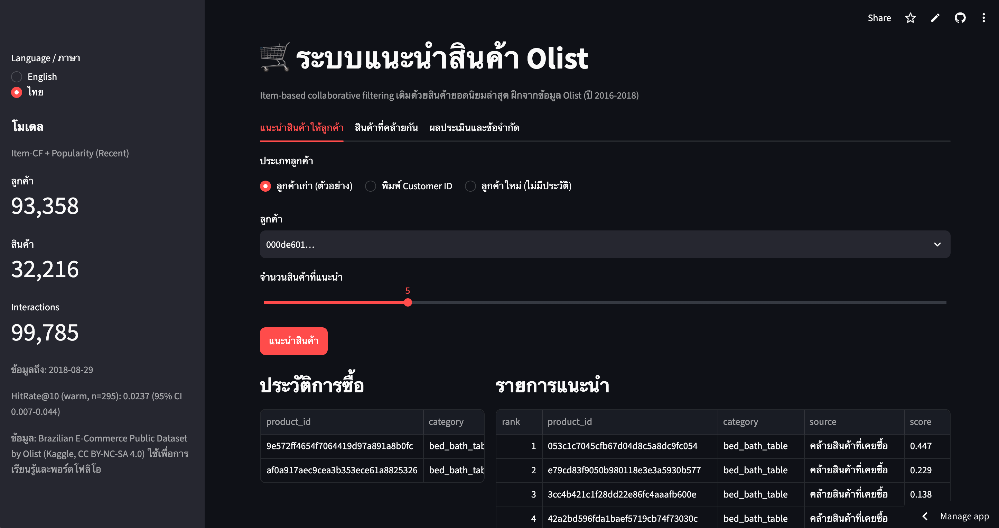

# E-Commerce Recommendation System (Olist)

An item-based collaborative filtering recommender built on the [Brazilian E-Commerce Public Dataset by Olist](https://www.kaggle.com/datasets/olistbr/brazilian-ecommerce), evaluated **offline with a temporal train/test split**, and served through a **FastAPI** service and a **Streamlit** demo.

**Live demo:** https://olist-recommender-wachirapat.streamlit.app/ *(free tier: the app sleeps when idle, so the first load can take a minute)*



## TL;DR

| | |
|---|---|
| Data | 110,197 delivered order items → 99,785 customer–product interactions (93,358 customers, 32,216 products, 99.997% sparse) |
| Evaluation | Temporal split (cutoff 2018-06-20), HitRate@10, bootstrap 95% CIs |
| Main finding | Item-CF + popularity fallback **matches** a strong popularity baseline in accuracy (difference not statistically significant) while recommending **~38× more distinct products** (1.54% vs 0.04% item coverage) |
| Why not better? | 98% of evaluated customers had no purchase history, and 94% of buyers bought a single product, so collaborative filtering can only help a small group |
| Delivered | Model artifact, REST API, interactive demo, full reproducible notebook |

> Results are **offline** only. There is no A/B test, so nothing here claims an effect on sales.

## Business problem

Recommending only best-sellers hides niche products. The goal was a personalised recommender that keeps accuracy at the level of a popularity baseline while surfacing a wider part of the catalogue.

## Approach

1. **Data engineering:** audited keys and joins across 6 Olist tables (orders, items, products, reviews, customers, category translation), kept exactly one review per order, and verified that no merge changed the number of rows.
2. **Interactions:** one binary interaction per (`customer_unique_id`, `product_id`) from `delivered` orders. `customer_unique_id` is used because `customer_id` changes with every order.
3. **Temporal split:** train on orders before the cutoff, test on orders after it. Products a customer already bought in train are excluded from the ground truth, so the task is recommending *new* products.
4. **Models:** Random, Popularity (all-time), Popularity (recent 90 days), Category-based, Item-based CF (cosine similarity on a sparse matrix), and a Hybrid.
5. **Statistics:** bootstrap 95% CIs, paired differences against the popularity baseline, and a rolling-origin check over three time windows.
6. **Serving:** the final model is retrained on all data and exported as plain arrays (`joblib`), loaded by both the API and the app through `recommender.py`.

## Results (HitRate@10 on warm customers)

Warm customers = customers with purchase history before the cutoff.

| Model | Hits / 295 | HitRate@10 | 95% CI | Item coverage |
|---|---|---|---|---|
| Popularity (recent 90d) | 7 | 0.0237 | 0.007 – 0.044 | 0.04% |
| **Item-CF + Popularity (shipped)** | 7 | 0.0237 | 0.007 – 0.044 | **1.54%** |
| Category-based + Popularity | 6 | 0.0203 | 0.007 – 0.037 | 1.57% |
| Hybrid (CF → Category → Popularity) | 5 | 0.0169 | 0.003 – 0.034 | 2.82% |

**Rolling check (3 time windows, 844 warm cases):** Item-CF + Popularity 0.0273 (23 hits) vs Popularity 0.0225 (19 hits). The paired difference is +0.0047 with a 95% CI of −0.0012 to +0.0118, so it includes zero: **no statistically significant improvement in accuracy**.

Other numbers worth knowing:
- Of 14,507 evaluated customers, only 295 (2.03%) were warm; 14,212 were cold-start and receive the popularity list.
- 41.39% of evaluated customer–product pairs involve a product that never appeared in the training period.
- Item-CF produces its own candidates for 46.78% of warm customers; the rest are filled by popularity.
- NDCG@10 for Item-CF (0.0074) is slightly below popularity (0.0086) on this group.

## Limitations

- Very few warm customers, so every comparison has wide confidence intervals.
- The same test period was used to choose and report the model (no separate validation set); the rolling check reduces, but does not remove, this concern.
- A purchase is implicit feedback: it does not prove the customer liked the product.
- "Real-time" here means the API answers instantly from a pre-trained model; the model is retrained in batches, not on every purchase.
- Offline metrics only; no A/B test.

## Project structure

```
.
├── app.py                  # Streamlit demo (English / Thai)
├── api.py                  # FastAPI service
├── recommender.py          # Model loading + recommendation logic shared by app and API
├── models/
│   └── recommender_itemcf_v1.joblib
├── notebooks/
│   └── E_commerce_Recommendation_System.ipynb   # full analysis, from raw CSVs to exported model
├── docs/
│   ├── demo.png
│   └── results_summary.json
├── requirements.txt
└── LICENSE
```

## Quick start

```bash
pip install -r requirements.txt

# Streamlit demo
streamlit run app.py

# REST API (Swagger UI at http://127.0.0.1:8000/docs)
uvicorn api:app --reload
```

The pinned versions in `requirements.txt` match the environment that trained the model. The model file stores NumPy/SciPy/pandas objects, so loading it with very different versions can fail. Python 3.13 was used.

### API examples

```bash
curl "http://127.0.0.1:8000/recommend/<customer_id>?k=5"
curl "http://127.0.0.1:8000/similar/<product_id>?k=5"
curl "http://127.0.0.1:8000/model-info"
```

`/recommend` returns `known_customer: false` for IDs with no history and falls back to recent popular products. Each item has a `source` of `similar_items` (collaborative filtering) or `popular_recent` (fallback). `/similar` also returns `shared_buyers`, the number of customers who bought both products, because similarity from one or two shared buyers is weak evidence.

Average in-process latency was about 0.43 ms per recommendation on Colab (model already in memory, HTTP excluded).

## Reproduce the analysis

1. Open `notebooks/E_commerce_Recommendation_System.ipynb` in Colab (or Jupyter).
2. Provide the data in one of three ways: set `OLIST_DATA_DIR`, place the CSVs in the Drive path shown in the first cell, or let the notebook download them from Kaggle via `kagglehub`.
3. Run top to bottom. Each stage ends with a `CHECKPOINT` block that prints the numbers quoted in this README.

## Data and license

- Data: [Brazilian E-Commerce Public Dataset by Olist](https://www.kaggle.com/datasets/olistbr/brazilian-ecommerce) on Kaggle, released under **CC BY-NC-SA 4.0**. The raw data is not included in this repository.
- The model file contains identifiers and interaction data derived from that dataset, so it is shared under the same terms (non-commercial, share-alike, attribution to Olist). It is included for demonstration and portfolio purposes.
- The code in this repository is MIT-licensed (see `LICENSE`).

## Possible next steps

- Add browsing or add-to-cart events to increase the number of interactions per customer.
- Use product text or images (content-based) for new products and cold-start customers.
- Run an online A/B test before claiming any business impact.
